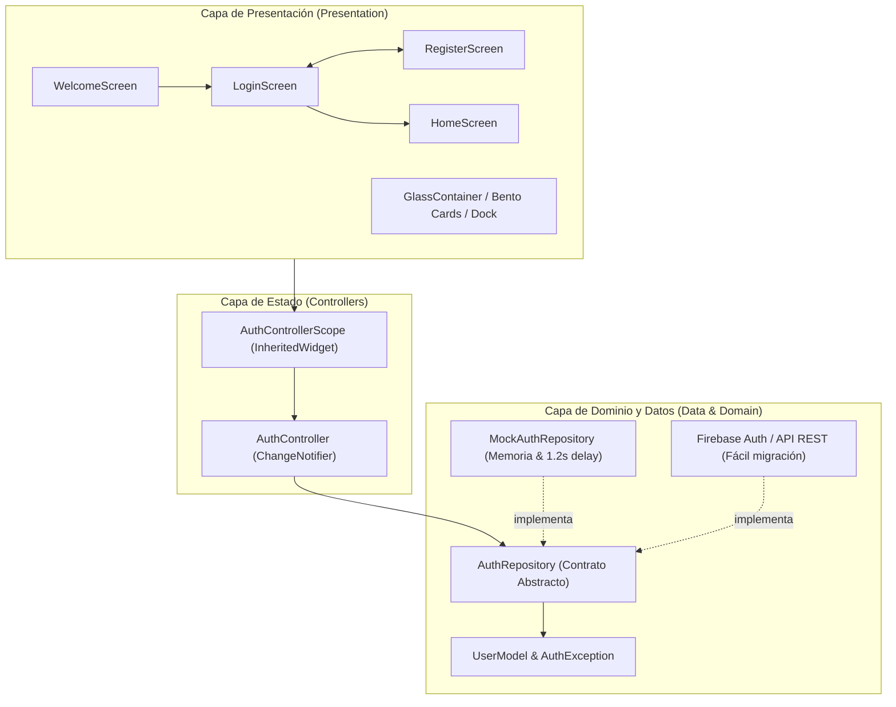

# ⚡ BOSSUX • Fitness & Health Hub (Cal AI Style)

[](https://flutter.dev)
[](https://dart.dev)
[](https://flutter.dev)
[](#-arquitectura-del-proyecto)
[](LICENSE)

Aplicación multiplataforma de alto rendimiento diseñada para el seguimiento de entrenamiento, macronutrientes y hábitos deportivos de atletas y entusiastas del fitness. Combina la estética deportiva de alto contraste inspirada en **Cal AI** con el acabado vítreo ultralimpio (*Liquid Glass*) de **Apple visionOS**.

---

## 📸 Vista Previa y Diseño

| Bienvenida con Video | Login "Libro Abierto" | Dashboard Bento Grid | Dock Flotante visionOS |
| :---: | :---: | :---: | :---: |
|  |  |  |  |

---

## 🚀 Características Principales

* **Onboarding Dinámico con Video**: Pantalla de bienvenida inmersiva con video deportivo en bucle silencioso (`assets/videos/fitness_bg.mp4`), badge de idioma y selector rápido.
* **Layout Adaptativo "Libro Abierto" (Book Spread)**: Experiencia visual de dos páginas tipo revista interactiva en navegadores y pantallas de escritorio, adaptándose a un modal estilizado en dispositivos móviles.
* **Autenticación Completa y Social**:
  * Formulario reactivo de inicio de sesión con validaciones estrictas en tiempo real.
  * Alternancia animada de visibilidad de contraseñas.
  * Botones de acceso social con Google y Apple.
  * Flujo de registro de atletas integrado.
* **Dashboard del Atleta (Bento Grid)**:
  * Selector interactivo de días de entrenamiento.
  * Anillo de progreso calórico con desglose de macronutrientes (Proteínas, Carbohidratos, Grasas).
  * Registro de comidas recientes con sellos de tiempo y valores nutricionales.
* **Dock Inferior Flotante**: Barra de navegación estilo Apple visionOS con desenfoque translúcido, transiciones suaves y botón de acción rápida central (+).
* **Módulo de Analíticas y Salud**: Vista semanal con gráficos de barras de rendimiento, registro de hidratación y contador de pasos.
* **Ajustes y Perfil**: Configuración de metas de nutrición diaria, estado de suscripción Pro y switches de sincronización de sensores.

---

## 🛠️ Tecnologías Utilizadas

| Categoría | Tecnología / Paquete | Propósito |
| :--- | :--- | :--- |
| **Framework Base** | **Flutter SDK** (`^3.13.7`) | Desarrollo multiplataforma con renderizado a 60/120 FPS. |
| **Lenguaje** | **Dart 3** | Tipado estricto, inmutabilidad y seguridad ante nulos (*Sound Null Safety*). |
| **Diseño y Tema** | **Material 3 Dark** | Personalización completa de tokens de color, bordes y tipografías. |
| **Multimedia** | [`video_player: ^2.14.1`](https://pub.dev/packages/video_player) | Reproducción eficiente de video en bucle para el fondo de bienvenida. |
| **Iconografía** | **Material Icons** & [`cupertino_icons`](https://pub.dev/packages/cupertino_icons) | Conjunto de glifos deportivos, técnicos e institucionales nativos. |
| **Gestión de Estado** | **ChangeNotifier + InheritedWidget** | Arquitectura reactiva nativa sin dependencias pesadas (`AuthControllerScope` + `ListenableBuilder`). |
| **Efectos Visuales** | **BackdropFilter + Custom Painters** | Cristal esmerilado translúcido (*Liquid Glass*) con desenfoque de 32px y bisel de luz especular. |
| **Pruebas y Calidad** | `flutter_test` & `flutter_lints: ^6.0.0` | Pruebas unitarias de validadores, repositorios y smoke tests de UI. |

---

## 🏛️ Arquitectura del Proyecto

El código implementa el patrón **Feature-First** combinado con principios de **Clean Architecture**, asegurando separación de responsabilidades, alta cohesión y bajo acoplamiento:



> [!NOTE]
> Para una descripción exhaustiva de cada archivo y módulo, consulta el documento técnico completo en [`structure.md`](structure.md).

---

## 📂 Estructura de Directorios

```text
LoginFlutter/
├── assets/
│   └── videos/
│       └── fitness_bg.mp4                   # Video en bucle de bienvenida
├── img/                                     # Capturas de pantalla y recursos gráficos
│   ├── gama_Colores/                        # Paleta deportiva de referencia
│   ├── homeIMG/                             # Capturas de Home y Bento Grid
│   ├── loginIMG/                            # Capturas de Login y Welcome
│   └── NAVBAR/                              # Referencia del Dock flotante
├── lib/
│   ├── main.dart                            # Punto de entrada de la aplicación
│   ├── app.dart                             # Configuración global de MaterialApp y rutas
│   ├── core/                                # Componentes transversales
│   │   ├── constants/                       # Paletas de color, espaciados, tipografías y textos
│   │   ├── routing/                         # Nombres de rutas y navegaciones
│   │   ├── theme/                           # ThemeData en modo oscuro Material 3
│   │   ├── utils/                           # Validadores puros (Email, Password, Strings)
│   │   └── widgets/                         # Apple Ambient Background, GlassContainer, PressableScale
│   └── features/                            # Módulos por funcionalidad
│       ├── auth/                            # Autenticación (Login, Register, Welcome)
│       │   ├── data/                        # Repositorios, modelos y excepciones
│       │   └── presentation/                # Controladores, pantallas y componentes de formulario
│       └── home/                            # Dashboard del Atleta post-login
│           └── presentation/                # Bento Grid, Dock flotante, Analíticas y Ajustes
└── test/
    ├── widget_test.dart                     # Smoke test de flujo completo de bienvenida
    ├── core/utils/validators_test.dart      # Pruebas unitarias de validación
    └── features/auth/data/                  # Pruebas unitarias de autenticación
```

---

## 🎨 Sistema de Diseño y Tokens

* **Volt Neon (`#CCFF00`)**: Color primario CTA de alta visibilidad, usado en botones de acción principal, badges y acentos de progreso.
* **Cian Eléctrico (`#00F0FF`)**: Acento secundario tecnológico para métricas y orbes de luz.
* **Lienzo Ónix Profundo (`#070A12`)**: Fondo suave con micro-gradientes (evita el negro plano 100%).
* **Efecto Liquid Glass**: Contenedores esmerilados translúcidos con `BackdropFilter` (32px de desenfoque) y borde con bisel reflectivo cenital (`rgba(255, 255, 255, 0.28)`).
* **Micro-interacciones Elásticas**: Componente `PressableScale` que comprime sutilmente los botones al tacto (`0.965`) generando retroalimentación cinemática.

---

## 🔑 Credenciales Demo

Para probar el inicio de sesión sin registrar un nuevo usuario:

* **Correo electrónico:** `athlete@calai.fit` (o `demo@calai.app`)
* **Contraseña:** `Password123!`

*(O puedes hacer clic en **"Crear cuenta"** o usar los accesos sociales simulados de Google y Apple).*

---

## 💻 Instalación y Ejecución Local

### Prerrequisitos
* Tener instalado [Flutter SDK](https://docs.flutter.dev/get-started/install) (versión $\ge$ 3.13.7).
* Navegador Chrome (para Web) o un dispositivo Android / iOS conectado / emulador.

### Pasos

1. **Clonar el repositorio:**
   ```bash
   git clone https://github.com/Victor30700/LoginFlutter.git
   cd LoginFlutter
   ```

2. **Instalar dependencias:**
   ```bash
   flutter pub get
   ```

3. **Ejecutar en la plataforma preferida:**
   * **Navegador Web (Chrome):**
     ```bash
     flutter run -d chrome
     ```
   * **Dispositivo Android / Emulador:**
     ```bash
     flutter run
     ```
   * **Escritorio Windows:**
     ```bash
     flutter run -d windows
     ```

4. **Ejecutar la suite de pruebas automatizadas:**
   ```bash
   flutter test
   ```

---

## 📦 Compilación para Producción

* **Generar APK para Android:**
  ```bash
  flutter build apk --release
  ```
* **Compilar para Web:**
  ```bash
  flutter build web --release
  ```

---

## 👤 Autor

* **Víctor Hugo Saldaña**
* GitHub: [@Victor30700](https://github.com/Victor30700)
* Correo: [gsaldana709@gmail.com](mailto:gsaldana709@gmail.com)
