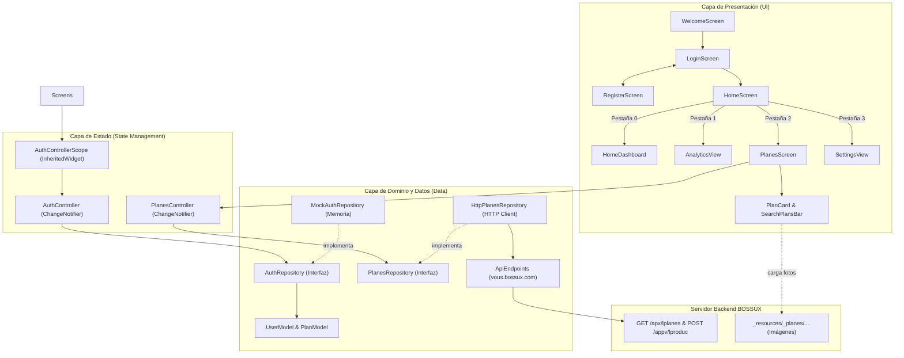

# Estructura del Proyecto: LoginFlutter (BOSSUX • Fitness Hub)

Este archivo documenta la organización y el propósito de cada directorio y archivo en la aplicación.
Las fases y progreso de implementación se encuentran en [`plan.md`](file:///D:/scripts-csharp/ProFlutters/LoginFlutter/plan.md), y los lineamientos de diseño en [`PRODUCT.md`](file:///D:/scripts-csharp/ProFlutters/LoginFlutter/PRODUCT.md) y [`context.md`](file:///D:/scripts-csharp/ProFlutters/LoginFlutter/context.md).

---

## Árbol de Directorios y Archivos

```text
LoginFlutter/
├── .gitignore                               # Configuración de exclusiones de Git (APKs, builds, caches)
├── analysis_options.yaml                    # Reglas de linter y calidad de código Dart
├── pubspec.yaml                             # Dependencias, SDK y declaración de assets/videos
├── pubspec.lock                             # Bloqueo determinista de versiones de dependencias
├── README.md                                # Documentación principal del repositorio y guía rápida
├── PRODUCT.md                               # Contexto del producto y especificaciones de diseño
├── plan.md                                  # Épicas, fases de trabajo y progreso
├── structure.md                             # Estructura técnica y catálogo de archivos del proyecto
├── context.md                               # Fuentes de diseño, iconos, paletas y tokens visuales
│
├── assets/                                  # Recursos estáticos de la aplicación
│   └── videos/
│       └── fitness_bg.mp4                   # Video de entrenamiento en bucle para pantalla de bienvenida
│
├── img/                                     # Capturas de pantalla y referencias visuales de diseño
│   ├── gama_Colores/                        # Paleta deportiva de referencia
│   ├── homeIMG/                             # Capturas de la pantalla Home y widgets
│   ├── loginIMG/                            # Capturas del flujo de acceso y bienvenida
│   └── NAVBAR/                              # Referencias del Dock de navegación flotante
│
├── lib/
│   ├── main.dart                            # Punto de entrada: inicializa dependencias y ejecuta BossuxApp
│   ├── app.dart                             # BossuxApp: configuración de MaterialApp, temas y rutas
│   │
│   ├── core/                                # Código transversal y compartido (Design System & Utils)
│   │   ├── constants/
│   │   │   ├── api_endpoints.dart           # Endpoints oficiales BOSSUX (vous.bossux.com) y resolución de fotos
│   │   │   ├── app_colors.dart              # Paleta deportiva (Volt Neon #CCFF00, Cyan, Slate, Onyx)
│   │   │   ├── app_spacing.dart             # Escala de espaciados y radios de curvatura
│   │   │   ├── app_strings.dart             # Textos centralizados en español (etiquetas, botones, errores)
│   │   │   └── app_text_styles.dart         # Jerarquía tipográfica geométrica (estilo Inter / SF Pro)
│   │   ├── routing/
│   │   │   └── app_routes.dart              # Rutas nombradas (/welcome, /login, /register, /home) y guards
│   │   ├── theme/
│   │   │   └── app_theme.dart               # ThemeData de Material 3 Dark personalizado con tokens
│   │   ├── utils/
│   │   │   └── validators.dart              # Validadores de formularios (email RFC 5322, password, nombres)
│   │   └── widgets/                         # Componentes visuales Apple Liquid Glass y micro-interacciones
│   │       ├── apple_ambient_background.dart# Fondo degradado con orbes difuminados de luz aurora
│   │       ├── glass_container.dart         # Contenedor esmerilado translúcido con bisel reflectivo
│   │       ├── pressable_scale.dart         # Micro-interacción de compresión elástica (resorte táctil)
│   │       └── staggered_entrance.dart      # Animación de entrada progresiva por fases (curva cúbica)
│   │
│   └── features/                            # Módulos organizados por funcionalidad (Feature-First)
│       ├── auth/                            # Módulo de Autenticación y Acceso
│       │   ├── data/
│       │   │   ├── exceptions/
│       │   │   │   └── auth_exception.dart      # Excepciones tipadas (credenciales inválidas, usuario existente)
│       │   │   ├── models/
│       │   │   │   └── user_model.dart          # Modelo inmutable de usuario (id, nombre, email, proveedor)
│       │   │   └── repositories/
│       │   │       ├── auth_repository.dart     # Contrato abstracto independiente de la implementación
│       │   │       └── mock_auth_repository.dart# Implementación en memoria con latencia y usuarios demo
│       │   └── presentation/
│       │       ├── controllers/
│       │       │   ├── auth_controller.dart     # ChangeNotifier: estado reactivo de sesión, carga y errores
│       │       │   └── auth_controller_scope.dart# InheritedWidget para inyección de dependencias en árbol
│       │       ├── screens/
│       │       │   ├── welcome_screen.dart      # Bienvenida con video en bucle y selector de idioma
│       │       │   ├── login_screen.dart        # Login Cal AI con campos reactivos y acceso Google/Apple
│       │       │   └── register_screen.dart     # Registro de nuevos atletas con validaciones estrictas
│       │       └── widgets/
│       │           ├── auth_error_banner.dart   # Banner animado de errores sobre el formulario
│       │           ├── book_spread_card.dart    # Contenedor adaptativo estilo "Libro Abierto" (Web/Móvil)
│       │           ├── custom_primary_button.dart# Botón Volt Neon con spinner de carga integrado
│       │           ├── custom_text_field.dart   # Input con alternador de visibilidad y validación en vivo
│       │           └── social_login_button.dart # Botones de autenticación social (Google y Apple)
│       │
│       └── home/                            # Módulo Dashboard del Atleta (Post-login)
│           └── presentation/
│               ├── screens/
│               │   └── home_screen.dart         # Dashboard Bento Grid: selector de fecha, calorías y macros
│               └── widgets/
│                   ├── analytics_view.dart      # Gráficos semanales de rendimiento, macros y agua
│                   ├── floating_bottom_nav_bar.dart# Dock flotante visionOS con selector de tab y botón (+)
│                   └── settings_view.dart       # Vista de perfil Pro, objetivos nutricionales y ajustes
│
│       └── planes/                          # Módulo Catálogo de Planes y Membresías (Épica 8)
│           ├── data/
│           │   ├── models/
│           │   │   └── plan_model.dart          # Modelo inmutable de membresía (nombre, precio, tiempo, foto)
│           │   └── repositories/
│           │       ├── planes_repository.dart   # Contrato abstracto
│           │       └── http_planes_repository.dart# Integración con vous.bossux.com (lplanes & lproduc)
│           └── presentation/
│               ├── controllers/
│               │   └── planes_controller.dart   # Estado reactivo, búsqueda en vivo y filtrado
│               ├── screens/
│               │   └── planes_screen.dart       # Catálogo con pull-to-refresh y modal de inscripción
│               └── widgets/
│                   ├── plan_card.dart           # Tarjeta Apple Liquid Glass con foto real y Volt Lime
│                   └── search_plans_bar.dart    # Barra de búsqueda (BuscarCodigo) y filtro de activos
│
└── test/
    ├── widget_test.dart                     # Smoke test: renderizado de Welcome y transición a Login
    ├── core/
    │   └── utils/
    │       └── validators_test.dart         # Pruebas unitarias de validadores de email y password
    └── features/
        ├── auth/
        │   └── data/
        │       └── mock_auth_repository_test.dart# Pruebas unitarias completas de autenticación y registro
        └── planes/
            └── data/
                └── plan_model_test.dart     # Pruebas unitarias de parseo JSON real y formateo de planes
```

---

## Descripción Detallada por Capas

### 1. `lib/core/` (Capa Transversal)
* **`constants/`**: Contiene la única fuente de verdad para valores inmutables en la app:
  * `ApiEndpoints`: Centraliza URLs de producción de BOSSUX (`https://vous.bossux.com/apx/lplanes`, `/appv/lproduc`) y utilidad de resolución de fotos relativas (`resolveImageUrl`).
  * `AppColors`: Paleta de alto contraste inspirada en Cal AI (Volt Neon `#CCFF00`, Cian Eléctrico `#00F0FF`, Índigo Aurora `#6366F1`, Canvas Ónix `#070A12`).
  * `AppSpacing`: Escala uniforme de espaciados (4px a 48px) y radios de borde (`radiusMd: 16`, `radiusLg: 24`, `radiusPill: 999`).
  * `AppStrings`: Textos internacionalizables en español para evitar cadenas sueltas en widgets.
  * `AppTextStyles`: Jerarquía tipográfica con pesos semibold y bold para estética deportiva.
* **`routing/`**: Centraliza nombres de rutas (`/welcome`, `/login`, `/register`, `/home`, `/planes`) y gestiona transiciones adaptativas.
* **`theme/`**: Configura `ThemeData` en modo oscuro Material 3 con estilos personalizados para inputs, botones y efectos de foco.
* **`utils/`**: Utilidades puras reutilizables como validaciones de correo electrónico, longitud de clave y coincidencia de confirmación.
* **`widgets/`**: Biblioteca de micro-componentes de interfaz:
  * `AppleAmbientBackground`: Genera una atmósfera reactiva con orbes de color difuminados.
  * `GlassContainer`: Implementa cristal líquido mediante `BackdropFilter` con desenfoque gaussiano de 32px y bisel especular.
  * `PressableScale`: Añade micro-interacciones táctiles de compresión física (`0.965`) en clics/taps.
  * `StaggeredEntrance`: Orquesta la entrada suave en cascada de los elementos en pantalla.

### 2. `lib/features/auth/` (Módulo de Acceso)
Sigue principios de **Clean Architecture** y **Separación de Responsabilidades**:
* **`data/`**:
  * **Contrato (`auth_repository.dart`)**: Define la interfaz abstracta (`signIn`, `signUp`, `signInWithGoogle`, `signOut`, `currentUser`). Permite migrar en el futuro a Firebase Auth, Supabase o una API REST sin alterar la capa de presentación.
  * **Implementación (`mock_auth_repository.dart`)**: Emula comportamiento de red real con latencia de 1.2 segundos, almacenamiento en memoria y usuarios predefinidos (`athlete@calai.fit`).
  * **Excepciones (`auth_exception.dart`)**: Tipificación de errores (`InvalidCredentialsException`, `EmailAlreadyInUseException`, `NetworkException`).
* **`presentation/`**:
  * **Controlador (`auth_controller.dart`)**: Extiende `ChangeNotifier` para gestionar estados inmutables (`idle`, `loading`, `authenticated`, `error`).
  * **Inyección (`auth_controller_scope.dart`)**: Utiliza `InheritedWidget` para entregar el controlador de forma limpia en el árbol de widgets.
  * **Pantallas**:
    * `WelcomeScreen`: Introducción con video deportivo en segundo plano (`fitness_bg.mp4`), badge de idioma y botón CTA de entrada.
    * `LoginScreen`: Formulario responsivo con layout estilo libro abierto en escritorio y modal en dispositivos móviles.
    * `RegisterScreen`: Flujo de creación de cuenta de atleta con confirmación de clave y validación en vivo.

### 3. `lib/features/home/` (Dashboard del Atleta)
* **`HomeScreen`**: Hub principal para atletas autenticados:
  * Selector de días de la semana interactivo.
  * Anillo de progreso calórico con desglose de macronutrientes (Proteínas, Carbohidratos, Grasas).
  * Registro de comidas recientes con sellos de tiempo y valores energéticos.
  * Navegación por pestañas mediante `IndexedStack` (Home, Analytics, Planes, Settings).
* **`widgets/`**:
  * `FloatingBottomNavBar`: Dock flotante con efecto de vidrio esmerilado que aloja 4 pestañas de navegación (Inicio, Analíticas, Planes y Ajustes) y botón rápido de registro (+).
  * `AnalyticsView`: Gráfico de barras semanal interactivo con métricas de salud (calorías quemadas, agua, pasos).
  * `SettingsView`: Configuración de metas nutricionales, perfil del atleta, interruptores de sincronización y botón de cierre de sesión.

### 4. `lib/features/planes/` (Catálogo de Membresías y Búsqueda de Productos)
Implementado bajo la **Épica 8** para sincronización directa con el backend en producción de BOSSUX:
* **`data/`**:
  * **Modelo (`plan_model.dart`)**: Modela de forma inmutable los planes con atributos clave: `nombre` (`plan`), `precio` numérico y formateado (`Bs. 250` o `GRATIS`), `tiempo` formateado con sufijos contextuales (`1 Mes`, `14 Días`, `1 Año`), y `fullImageUrl` que resuelve la URL absoluta en `https://vous.bossux.com/`.
  * **Contrato (`planes_repository.dart`)**: Define las operaciones esenciales `getPlanes()` y `searchProductos(query)`.
  * **Implementación (`http_planes_repository.dart`)**: Cliente HTTP robusto con timeouts y control de excepciones que consume `GET /apx/lplanes` y `POST /appv/lproduc` (emulando la función `BuscarCodigo()`).
* **`presentation/`**:
  * **Controlador (`planes_controller.dart`)**: `ChangeNotifier` que orquesta la carga de catálogo, filtrado local instantáneo, búsqueda remota y toggle de planes activos (`_soloActivos`).
  * **Pantalla (`planes_screen.dart`)**: Vista de catálogo con soporte para Pull-to-Refresh (`RefreshIndicator`), estados de carga animados (skeletons), manejo amigable de errores de red y modal inferior interactivo para confirmar inscripción.
  * **Componentes (`widgets/`)**:
    * `PlanCard`: Tarjeta de diseño *Apple Liquid Glass* con imagen real de red, fallback visual degradado con icono atlético, badge de duración, nombre destacado y precio en Volt Lime (`#CCFF00`).
    * `SearchPlansBar`: Barra de búsqueda reactiva con input oscuro, botón disparador `Buscar` y chip selector de "Solo Activos".

---

## Flujo de Datos y Dependencias


