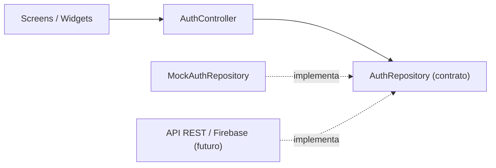

# Estructura del Proyecto: LoginFlutter

Este archivo documenta la organización y el propósito de cada directorio y archivo en la aplicación.
Las fases que crean cada archivo están en [`plan.md`](file:///D:/scripts-csharp/ProFlutters/LoginFlutter/plan.md).

---

## Árbol de Directorios y Archivos

```text
LoginFlutter/
├── .gitignore
├── analysis_options.yaml
├── pubspec.yaml
├── README.md
├── PRODUCT.md                               # Contexto del producto para las skills de diseño
├── plan.md                                  # Épicas, fases de trabajo y progreso
├── structure.md                             # Estructura y catálogo de archivos del proyecto
├── context.md                               # Fuentes de diseño, iconos, paletas y referencias
│
├── lib/
│   ├── main.dart                            # Punto de entrada: crea dependencias y ejecuta la app
│   ├── app.dart                             # MaterialApp: tema, rutas y controlador de sesión
│   │
│   ├── core/                                # Código compartido y transversal
│   │   ├── constants/
│   │   │   ├── app_colors.dart              # Paleta de colores
│   │   │   ├── app_spacing.dart             # Escala de espaciados y radios
│   │   │   ├── app_strings.dart             # Textos en español (etiquetas, botones, errores)
│   │   │   └── app_text_styles.dart         # Escala tipográfica
│   │   ├── routing/
│   │   │   └── app_routes.dart              # Nombres de rutas, generador y protección de /home
│   │   ├── theme/
│   │   │   └── app_theme.dart               # ThemeData de Material 3 con los tokens
│   │   ├── utils/
│   │   │   └── validators.dart              # Validaciones: email, contraseña, nombre, confirmación
│   │   └── widgets/                         # Widgets base estilo Apple y animaciones
│   │       ├── apple_ambient_background.dart# Fondo con orbes difuminados y atmósfera
│   │       ├── glass_container.dart         # Contenedor esmerilado con borde reflectivo
│   │       ├── pressable_scale.dart         # Micro-interacción de compresión elástica
│   │       └── staggered_entrance.dart      # Entrada coreografiada progresiva
│   │
│   └── features/                            # Módulos por funcionalidad (Feature-First)
│       ├── auth/                            # Acceso: bienvenida con video, login, registro, login social
│       │   ├── data/
│       │   │   ├── exceptions/
│       │   │   │   └── auth_exception.dart          # Errores tipados de autenticación
│       │   │   ├── models/
│       │   │   │   └── user_model.dart              # Usuario: id, nombre, email, proveedor
│       │   │   └── repositories/
│       │   │       ├── auth_repository.dart         # Contrato abstracto (mock, API o Firebase)
│       │   │       └── mock_auth_repository.dart    # Implementación en memoria con retraso
│       │   └── presentation/
│       │       ├── controllers/
│       │       │   ├── auth_controller.dart         # ChangeNotifier: estado de sesión y errores
│       │       │   └── auth_controller_scope.dart   # InheritedWidget para proveer el controlador
│       │       ├── screens/
│       │       │   ├── welcome_screen.dart          # Bienvenida con video en bucle (BOSSUX)
│       │       │   ├── login_screen.dart            # Iniciar sesión BOSSUX con Google
│       │       │   └── register_screen.dart         # Crear cuenta
│       │       └── widgets/
│       │           ├── auth_error_banner.dart       # Mensaje de error sobre el formulario
│       │           ├── book_spread_card.dart        # Contenedor Libro Abierto adaptativo (Desktop/Mobile)
│       │           ├── custom_primary_button.dart   # Botón principal con estado de carga
│       │           ├── custom_text_field.dart       # Campo de texto con error y ver/ocultar clave
│       │           └── social_login_button.dart     # Botones Google y Apple
│       │
│       └── home/                            # Destino tras iniciar sesión
│           └── presentation/
│               ├── screens/
│               │   └── home_screen.dart             # Bento Grid de macros, racha y registros recientes
│               └── widgets/
│                   ├── analytics_view.dart          # Gráfico de barras semanal y métricas de salud
│                   ├── floating_bottom_nav_bar.dart # Dock inferior flotante y botón rápido (+)
│                   └── settings_view.dart           # Perfil pro, metas de nutrición y switches de sensores
│
└── test/
    ├── core/
    │   └── utils/
    │       └── validators_test.dart                 # Pruebas de validadores
    └── features/
        └── auth/
            ├── data/
            │   └── mock_auth_repository_test.dart   # Pruebas del repositorio mock
            └── presentation/
                ├── login_screen_test.dart           # Pruebas de widget del Login
                └── register_screen_test.dart        # Pruebas de widget del Registro
```

---

## Descripción por Carpetas

### `lib/core/`
* **`constants/`**: Valores constantes de toda la app: colores, espaciados, tipografía y textos. Las pantallas no usan valores sueltos.
* **`routing/`**: Define las rutas `/login`, `/register` y `/home`, y redirige a `/login` si no hay sesión.
* **`theme/`**: Aplica los tokens al `ThemeData` de Material 3 (inputs, botones, snackbars).
* **`utils/`**: Funciones puras, como los validadores del formulario.

### `lib/features/auth/`
* **`data/`**: Todo lo que habla con la fuente de datos.
  * **`repositories/auth_repository.dart`** es el contrato. Hoy lo implementa `mock_auth_repository.dart`; mañana puede ser una API REST o Firebase sin tocar las pantallas.
  * **`exceptions/`** define los errores que el repositorio puede lanzar.
* **`presentation/`**: Lo que ve y toca la persona.
  * **`controllers/auth_controller.dart`** conecta las pantallas con el repositorio y expone el estado (`idle`, `loading`, `authenticated`, `error`).
  * **`screens/`** y **`widgets/`** son las pantallas y piezas reutilizables del acceso.

### `lib/features/home/`
* Pantalla posterior al inicio de sesión: saludo, estado vacío de plantas y botón para cerrar sesión.

### `test/`
* Refleja la estructura de `lib/`. Pruebas unitarias para validadores y repositorio, y pruebas de widget para las pantallas.

### Binarios Compilados (`build/`)
* **Android APK**: [`app-release.apk`](file:///D:/scripts-csharp/ProFlutters/LoginFlutter/build/app/outputs/flutter-apk/app-release.apk) ubicado en `build/app/outputs/flutter-apk/app-release.apk` (46.5 MB, release optimizada para dispositivos Android).
* **Web**: `build/web/` generado y listo para despliegue estático o pruebas locales.

---

## Flujo de dependencias


